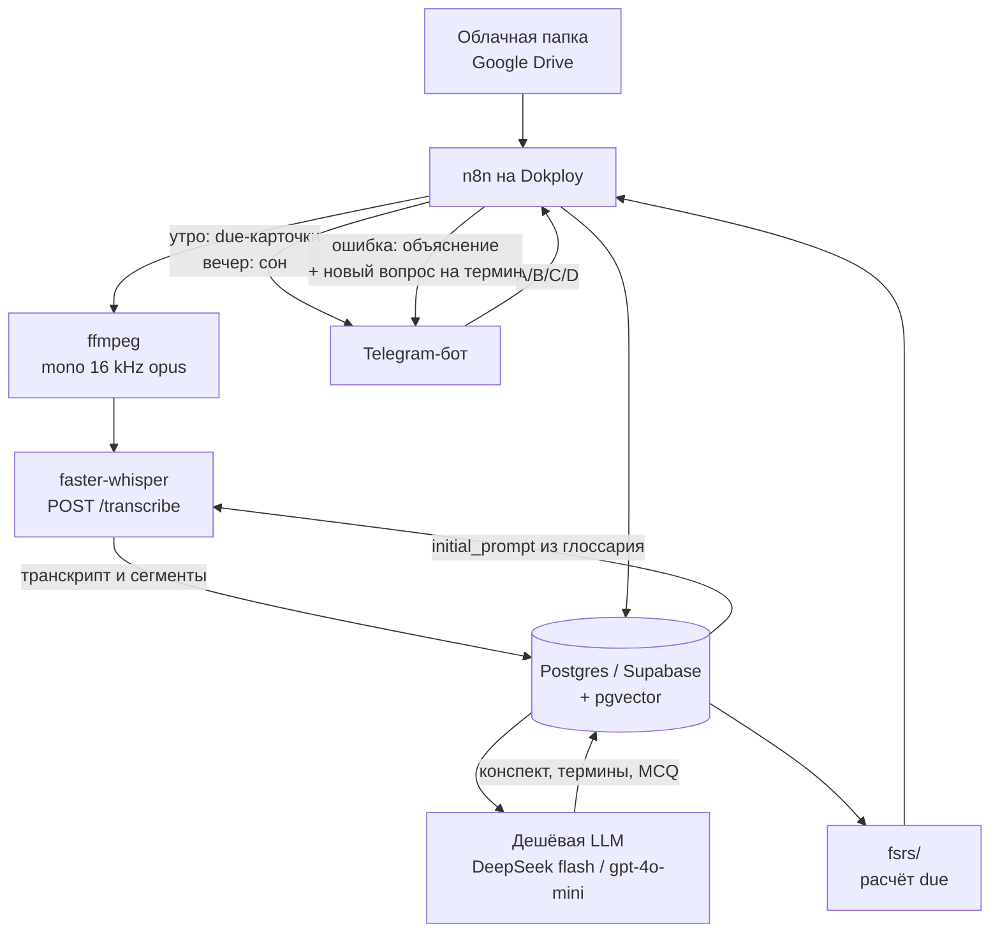

# План реализации: тренажёр памяти для курса психологии

Статус: предложение фазы 1 для владельца (Сергей). Это каркас, не выполненная реализация. Workflow в n8n и миграции базы появляются после явного approve. Миграции на проде — отдельным подтверждением. Исходные рамки — в [kickoff_prompt.md](kickoff_prompt.md).

Студентка — Наталья. Материалы курса лежат в [папке Google Drive](https://drive.google.com/drive/folders/1FwTgobJc50F4vTe0dxNOaZZTw7QdGnJP). Репозиторий публичный, поэтому видео, аудио, транскрипты и конспекты лекций в git не входят.

## Продукт

Метод учёбы, под который собирается система:

1. **Кодирование.** Термины с жизненными примерами, краткий конспект и схемы, не меньше 10 вопросов с выбором ответа из жизни на подтему. Ошибка в квизе даёт объяснение и новый вопрос на тот же термин.
2. **Консолидация.** Пауза после учёбы, затем смешанный квиз 3–4 тем. Озвучка в машине с паузой «дальше» — фаза 2. В MVP её нет, схема под неё не закрывается.
3. **Интервальные повторения (FSRS)** и короткое вечернее напоминание про сон.

Цепочка одной лекции: файл в облаке → job n8n → ffmpeg (mono 16 kHz) → faster-whisper → транскрипт в Postgres → конспект дешёвой LLM по [prompts/konspekt_v1.md](../prompts/konspekt_v1.md) → термины и MCQ → карточки FSRS → Telegram.

## Архитектура

Где что живёт:

| Часть | Место |
|---|---|
| Оркестрация | n8n на Dokploy. Экспорт — `workflows/` |
| Данные | Postgres/Supabase + pgvector на Dokploy. SQL — `db/migrations/` |
| Речь | `services/whisper`, self-host, без платы за API |
| Интервалы | `fsrs/`, чистая функция, без сети и без базы |
| Бот | `bot/`. Отдельный процесс — только если webhook n8n перестаёт хватать |
| Медиа и тексты лекций | Google Drive и локальный `data/` |

Яндекс.Диск в kickoff указан как допустимый второй источник того же ingest. Каноническая папка курса сейчас — Google Drive по ссылке выше.

Ориентир из теста железа: видео 2–3 GB, аудио 16 kHz mono opus около 5 MB на 24 минуты, Whisper int8 на 8 CPU около 0.15× realtime. Минимум сервера — 4 vCPU и 8 GB RAM, лучше 16 GB. Обычный Bot API Telegram принимает файлы до 20 MB, поэтому большие лекции приходят из облачной папки. Local Bot API — фаза 3.

## Компоненты

| Компонент | Каталог | Роль |
|---|---|---|
| Документы | `docs/` | Этот план и kickoff |
| Промпты | `prompts/` | `konspekt_v1.md` уже лежит. Остальные — после approve |
| Workflow | `workflows/` | JSON n8n и контракт каждого узла |
| Миграции | `db/migrations/` | В kickoff путь `sql/migrations`. Канон репозитория — этот |
| Whisper | `services/whisper/` | Dockerfile и `POST /transcribe` — в фазе реализации |
| Бот | `bot/` | В kickoff путь `services/bot`. Канон репозитория — этот |
| FSRS | `fsrs/` | Расчёт due |
| Фикстуры | `tests/fixtures/` | Регрессия. Реальные лекции — `tests/fixtures/private/` (в git только README). В kickoff путь `fixtures/lecture39` |

## Черновик схемы

Одна миграция `0001_init.sql` — предложение имени, файла в репозитории ещё нет. Если Postgres на Dokploy общий с другими проектами, таблицы живут в отдельной схеме; имя схемы фиксируется на аудите. Если база выделена продукту, достаточно `public`.

Пользователь в MVP один. Таблица `users` сразу допускает несколько строк, логику multi-user в MVP не делаем.

### users

- `id uuid` — первичный ключ
- `telegram_user_id bigint` — уникальный
- `display_name text`
- `timezone text` — по умолчанию `Europe/Moscow`
- `created_at timestamptz`

### courses

- `id uuid` — первичный ключ
- `user_id uuid` → `users`
- `title text`
- `drive_folder_id text`
- `created_at timestamptz`

### lectures

- `id uuid` — первичный ключ
- `course_id uuid` → `courses`
- `external_file_id text` — id файла в облаке; уникальность вместе с `course_id`
- `title text`
- `media_kind text` — `video` или `audio`
- `duration_sec integer`
- `status text` — `queued`, `audio_ready`, `transcribed`, `konspekt_ready`, `questions_ready`, `cards_ready`, `failed`
- `lecturer_name text` — пусто, если в метаданных нет
- `source_meta jsonb` — длительность и подписи из файла, без копии медиа
- `error text`
- `created_at timestamptz`, `updated_at timestamptz`

### lecture_texts

Текст транскрипта и конспект — данные продукта в базе, не файлы в git.

- `lecture_id uuid` — первичный ключ → `lectures`
- `transcript text`
- `konspekt_md text`
- `whisper_model text`
- `llm_model text`
- `updated_at timestamptz`

### chunks

Сегменты с таймкодами нужны фазе 2 («дальше») и разбору дыр ASR. Эмбеддинг в первую миграцию не входит: платный API эмбеддингов бюджет не предусматривает, а размерность `vector(N)` потом дорого менять. Колонку добавит отдельная миграция, когда появится локальная модель.

- `id uuid` — первичный ключ
- `lecture_id uuid` → `lectures`
- `ordinal integer` — уникальность вместе с `lecture_id`
- `start_ms integer`, `end_ms integer`
- `text text`

### glossary_terms

Канон написаний для `initial_prompt` Whisper и для промпта конспекта. Определение — только из сказанного в этой лекции.

- `id uuid` — первичный ключ
- `course_id uuid` → `courses`
- `lecture_id uuid` → `lectures`, пусто для заранее известного написания без определения
- `canonical text` — уникальность вместе с `course_id`
- `aliases text[]`
- `definition text`

### subtopics

Приёмка требует не меньше 10 MCQ на подтему, поэтому подтема — отдельная строка, а не поле в вопросе.

- `id uuid` — первичный ключ
- `lecture_id uuid` → `lectures`
- `ordinal integer`
- `title text`

### questions

- `id uuid` — первичный ключ
- `lecture_id uuid` → `lectures`
- `subtopic_id uuid` → `subtopics`
- `term_id uuid` → `glossary_terms`
- `stem text`
- `choice_a text`, `choice_b text`, `choice_c text`, `choice_d text`
- `correct_choice char(1)` — `A`–`D`
- `explanation text` — текст при ошибке
- `kind text` — в MVP `life_mcq`
- `created_at timestamptz`

### cards

Поля совместимы с FSRS, чтобы `fsrs/` пересчитывал строку целиком.

- `id uuid` — первичный ключ
- `user_id uuid` → `users`
- `question_id uuid` → `questions` — уникальность вместе с `user_id`
- `term_id uuid` → `glossary_terms` — поиск другого вопроса того же термина при ошибке
- `state smallint` — 0 new, 1 learning, 2 review, 3 relearning
- `stability double precision`
- `difficulty double precision`
- `due timestamptz`
- `last_review_at timestamptz`
- `reps integer`
- `lapses integer`
- `elapsed_days double precision`
- `scheduled_days double precision`

### reviews

- `id uuid` — первичный ключ
- `card_id uuid` → `cards`
- `user_id uuid` → `users`
- `rating smallint` — шкала FSRS 1–4
- `correct boolean`
- `chosen_choice char(1)`
- `channel text` — в MVP `telegram`; поле нужно, чтобы фаза 2 писала `car_audio` в ту же таблицу
- `reviewed_at timestamptz`

В MVP верный ответ пишется как Good (3), ошибка — как Again (1).

### settings

- `user_id uuid` — первичный ключ → `users`
- `morning_hour smallint` — час в `users.timezone`
- `evening_hour smallint`
- `desired_retention double precision` — стартовое значение 0.9
- `fsrs_weights jsonb` — дефолт выбранной реализации FSRS
- `whisper_model text` — стартовое значение `large-v3-turbo`
- `llm_model text`

### llm_usage

Журнал, по которому видно, что месяц укладывается в 500 ₽.

- `id uuid` — первичный ключ
- `lecture_id uuid` → `lectures`
- `workflow_name text`
- `model text`
- `prompt_tokens integer`
- `completion_tokens integer`
- `created_at timestamptz`

### jobs

Идемпотентность шагов ingest.

- `id uuid` — первичный ключ
- `lecture_id uuid` → `lectures`
- `step text`
- `status text`
- `idempotency_key text` — уникальный
- `started_at timestamptz`, `finished_at timestamptz`

Индексы первой миграции: `cards (user_id, due)`, `questions (term_id)`, `questions (subtopic_id)`, `lectures (status)`, `glossary_terms (course_id)`.

Задел фазы 2, в `0001` не входит: `questions.audio_script` для текста озвучки. Таймкоды уже есть в `chunks`.

## Workflow n8n

Имена — предложение. На аудите их сверяют с живыми workflow и контрактами. JSON в этом PR нет. Учётные данные (Telegram, Drive, LLM, Postgres) живут в credentials n8n.

| Имя | Триггер | Вход | Результат |
|---|---|---|---|
| `psy_01_ingest_cloud_folder` | cron или триггер папки | новый файл в папке курса | `lectures.status = queued`, строка в `jobs` |
| `psy_02_extract_audio` | завершение шага 01 | `lecture_id`, файл в `data/` | opus mono 16 kHz |
| `psy_03_transcribe` | завершение шага 02 | opus и `initial_prompt` из `glossary_terms` | `lecture_texts.transcript`, строки `chunks` |
| `psy_04_konspekt` | завершение шага 03 | блоки `МЕТАДАННЫЕ`, `ГЛОССАРИЙ`, `ТРАНСКРИПТ` | `lecture_texts.konspekt_md`, строка `llm_usage` |
| `psy_05_terms_and_questions` | завершение шага 04 | конспект, транскрипт, глоссарий | термины, подтемы, не меньше 10 MCQ на подтему |
| `psy_06_seed_fsrs_cards` | завершение шага 05 | вопросы | карточки `state = new`, `due = now`; повтор по `question_id` ничего не плодит |
| `psy_07_morning_due` | cron в часовом поясе студентки | карточки с `due <= now` | сообщения в Telegram, ограниченная пачка |
| `psy_08_quiz_callback` | callback query Telegram | выбор A/B/C/D | `reviews`, новый `due` через `fsrs/`; при ошибке — `explanation` и другой вопрос того же `term_id` |
| `psy_09_evening_reminder` | cron вечером | `settings` | одно короткое сообщение: лёгкое повторение и сон |

Повторный опрос папки не создаёт вторую лекцию: ключ — `course_id` + `external_file_id`. Повтор шага не создаёт вторую пачку вопросов: ключ — `jobs.idempotency_key`.

Новый вопрос при ошибке сначала берётся из уже сохранённого пула. Вызов LLM (`explain_miss`) — только когда по этому термину пул пуст, и он пишется в `llm_usage`.

## Промпты

| Файл | Фаза |
|---|---|
| `prompts/konspekt_v1.md` | есть. System prompt — раздел «Текст system prompt» внутри файла. В kickoff имя `prompts/konspekt.md.sys` |
| `prompts/extract_terms.md` | 1, после approve |
| `prompts/gen_questions.md` | 1, после approve. Вопросы из жизни привязаны к термину этой лекции |
| `prompts/explain_miss.md` | 1, после approve |
| `prompts/consolidate_quiz.md` | 2, смешанный квиз 3–4 тем |

Вход конспекта всегда один: `МЕТАДАННЫЕ` + `ГЛОССАРИЙ` + `ТРАНСКРИПТ` этой лекции. Модель не подмешивает другие лекции цикла.

## Фазы и приёмка

### Фаза 0 — каркас

Этот PR. Каталоги с README, план, промпт конспекта, kickoff, `AGENTS.md`, `.gitignore`, `.env.example`, русский README. В git нет секретов и нет материалов лекций.

### Фаза 1 — MVP

Дальше только после approve. Критерии из kickoff:

| # | Критерий |
|---|---|
| 1 | Новый файл в облачной папке создаёт job в n8n. Размер — любой, который держит диск |
| 2 | ffmpeg делает mono 16 kHz. Whisper вызывается с `initial_prompt` из глоссария курса |
| 3 | Транскрипт сохранён. Конспект собран по `prompts/konspekt_v1.md` из метаданных, глоссария и транскрипта |
| 4 | Термины и не меньше 10 жизненных MCQ на подтему лежат в Postgres |
| 5 | По вопросам созданы карточки FSRS. Утренний cron шлёт due-карточки в Telegram |
| 6 | Бот показывает квиз кнопками A/B/C/D. Ошибка даёт объяснение и новый вопрос на термин |
| 7 | Вечером уходит короткое напоминание: лёгкое повторение и сон |
| 8 | Есть прогон регрессии на фикстуре, журнал токенов LLM, месяц в пределах бюджета |

Эталон реальной лекции из kickoff (транскрипт, конспект, при наличии `audio_16k.opus` и `transcribe_meta.json`) хранится в `tests/fixtures/private/` или в Google Drive. В публичный git он не кладётся. Синтетическая фикстура без текста курса добавляется вместе с тестами фазы 1.

### Фаза 2

Озвучка и пауза «дальше», голосовые ответы, смешанный квиз 3–4 тем после паузы. Для этого уже заложены `chunks` с таймкодами, `reviews.channel` и чистый `fsrs/`.

### Фаза 3

Аналитика просадки терминов, несколько пользователей, Local Bot API. Ingest по умолчанию остаётся облачной папкой.

## Бюджет

Потолок — **500 ₽ в месяц** на работу продукта. Это замена платного распознавания в Telegram.

- Whisper: self-host, плата за API — 0. Модель `large-v3-turbo`, запасная `large-v3`, int8. Новую платную машину под ASR без согласия владельца не заказываем: расчёт на уже стоящий Dokploy.
- LLM: DeepSeek flash или gpt-4o-mini. Каждый вызов — строка в `llm_usage`.
- Эмбеддинги в фазе 1 не считаем платным API и колонку `vector` не создаём.
- Telegram Bot API без Local Bot API.
- Perplexity к продукту не подключается: он занят другими задачами и в этот бюджет не входит.
- Если сумма по журналу токенов за месяц приближается к 500 ₽, работа останавливается до решения владельца. Модель и частоту квиза сами не меняем.

## Риски

1. **Публичный репозиторий.** Транскрипт, конспект, аудио, видео или токен в коммите — утечка. Экспорт n8n перед коммитом проверяется на credentials и на куски лекций в пинах.
2. **Живые контракты n8n этому каркасу неизвестны.** Имена `psy_*` могут пересечься с уже работающими сценариями. Сначала аудит инстанса, имена в плане правятся по факту, чужие workflow не трогаем.
3. **Общая база Dokploy.** Миграция без своей схемы может задеть чужие таблицы. Имя схемы — часть плана, который утверждает владелец. Прод — отдельное «да».
4. **Диск.** Видео 2–3 GB качается в `data/`. После успешного opus локальное видео удаляется, копия в облаке остаётся. Перед загрузкой проверяется свободное место.
5. **Длина `initial_prompt`.** У Whisper порядок величины — около 200 токенов. В промпт идут канонические термины, не конспект. Неразобранное место в конспекте остаётся `[неразборчиво]`.
6. **Выдуманные термины и случаи.** Промпты извлечения и вопросов опираются на конспект и транскрипт этой лекции. Определение в глоссарии пишется только из сказанного.
7. **Токены на ошибках.** Пул из не меньше чем 10 вопросов на подтему закрывает повтор без нового вызова. Генерация «на лету» — запасной путь с записью в `llm_usage`.
8. **Размерность pgvector.** Колонку эмбеддинга не создавать, пока нет выбранной локальной модели.
9. **Часовой пояс cron.** n8n часто считает cron в UTC. Утро и вечер берутся из `settings` и `users.timezone`.
10. **Канал квиза.** Оценка карточки идёт через `reviews` и `fsrs/`, а не через одноразовую логику inline-кнопки. Иначе фазу 2 придётся встраивать в чужой workflow.

## Порядок работы фазы 1

1. Аудит: репозиторий, `AGENTS.md`, `.cursor/rules` (если появятся), живые workflow n8n, их контракты, Dokploy, какая именно база. На этом шаге ничего не менять.
2. Поправить этот план фактами аудита: реальные имена workflow, схема базы, есть ли ffmpeg на хосте. Остановиться и ждать approve.
3. После approve: миграция на не-продовой базе или явная транзакция, сервис Whisper, экспорт workflow в `workflows/`. Прод — отдельное подтверждение.
4. Конец каждого шага — короткий чеклист: сделано, проверить, дальше.

## Чеклист этого шага

- Сделано: каркас каталогов, план, промпт конспекта, kickoff, правила агентов, `.gitignore`, `.env.example`, README.
- Проверить в diff: нет медиа, нет транскриптов и конспектов лекций, нет значений секретов.
- Дальше: локальный Cursor с доступом к n8n делает аудит и ждёт approve. Workflow и миграции до этого не создавать.
